# Kibitka

**A cozy co-op road trip in a house on wheels.** 1988, a planned economy. Cats drive a house-truck
through twelve towns to pay off the debt father left them: haul the plan's cargo, deliver parcels,
trade through the window, keep the stove warm and the samovar hot. Play alone or with friends,
right in the browser.

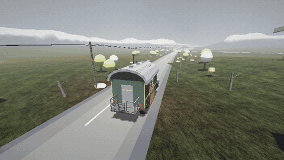

**[▶ Play in the browser](https://kibitka-web.fly.dev)** · English · [Русский](README.ru.md)

Free, no sign-up. Needs a desktop browser with keyboard and mouse; the first load is about 25 MB.
The game speaks English and Russian (switch in the lobby, `F2`, or in the pause menu, `Esc`).

| | |
|---|---|
|  |  |
| 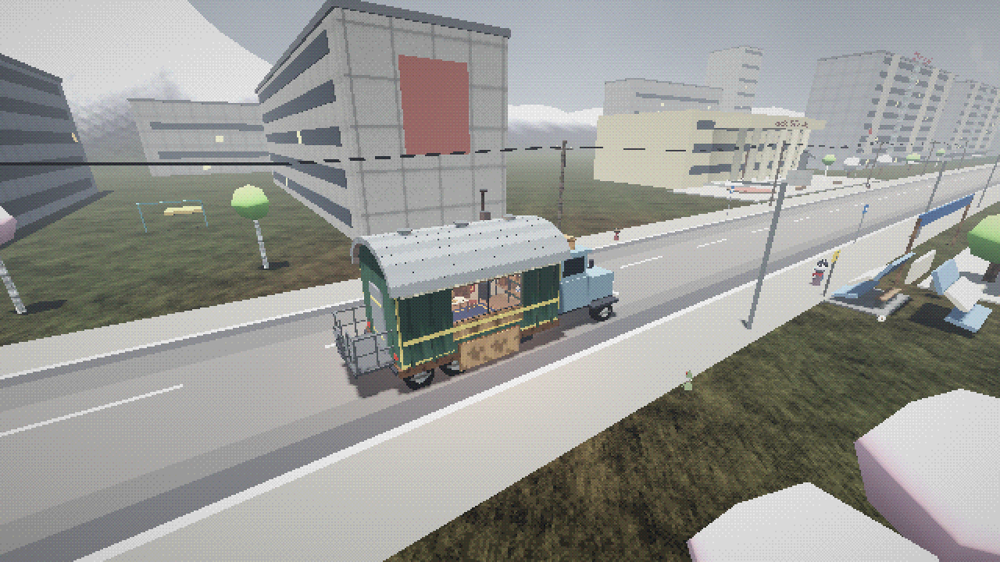 | 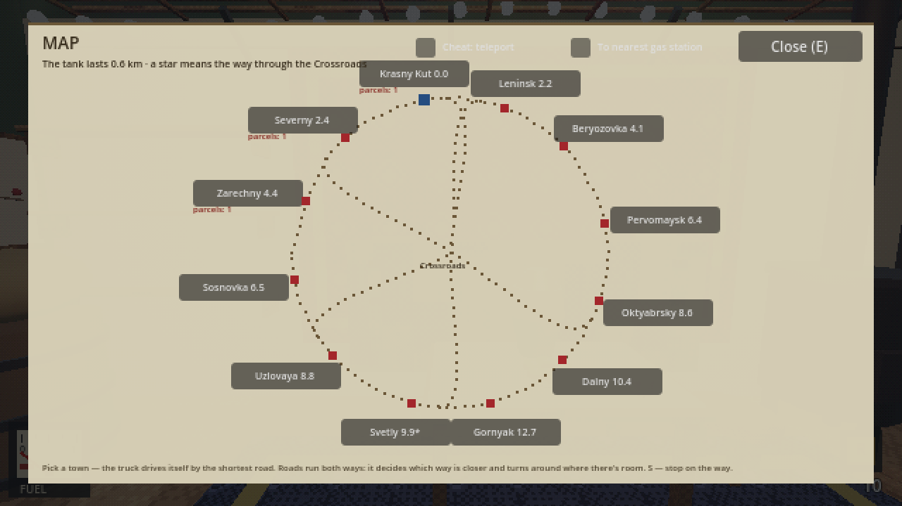 |

## What you do

- **Pay off father's debt.** Ten thousand rubles at the savings bank, in parts; once it is paid,
  buy the ticket and go after him. A private lender gives a quick start — and charges a percent a day.
- **Work for the plan.** Some towns got too much, others were forgotten: the supply sheet says
  which. A crate of the plan's cargo pays by transfer to the co-operative's account; take the account
  in cash once a week as a wage at the savings bank, or any day from the lender for 30%.
- **Ride together.** One player opens a lobby, friends join by a four-letter room code. Everyone
  shares the wagon and the wallet.
- **Trade through the window.** Every town makes something and lacks something. Buy cheap, carry it
  down the road, ring the bell and sell.
- **Parcels with stories.** A jar of jam for a student son, a lamp for a lighthouse: deliver a
  parcel and hear what happened next.
- **A home that lives.** Feed the stove, fry pancakes, roll dice at the tea table, play guitar at a
  bus stop, sleep till morning on the shelf.
- **Step outside.** Markets, a shooting range, fishing, a mine, an observatory in the mountains —
  and a gnome hidden in every special place.
- **A country around you.** Twenty-one people of the road — a factory director, a pusher, a
  shop manager, an inspector — rise or get sacked at the quarterly report. A fraternal republic is
  shipped goods out of the plan and the shops run short; a steamer from the West brings a surplus
  into the port. In summer parents send parcels to the pioneer camp.
- **Nothing is lost.** The game copies the world by itself at launch and once a game day; in the
  pause menu you make your own copies and put any of them back.

## Activities

Things to do at the booths happen in the world itself, with your own paws — no pop-up screens.

| Shooting range: take the rifle, hit the plates | Fishing: swing, cast, wait for the bite, reel in |
|---|---|
| 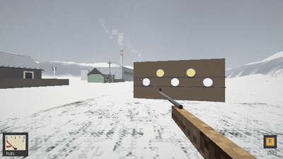 | 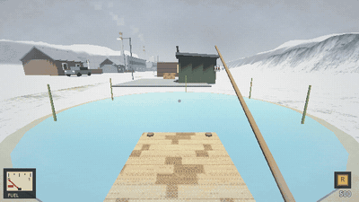 |

| | | |
|---|---|---|
| 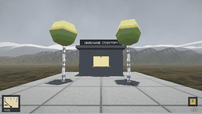 | 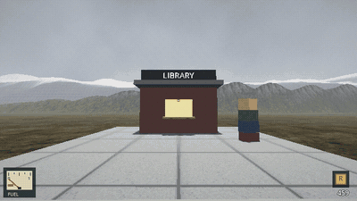 | 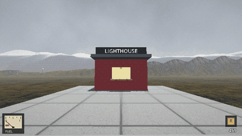 |
| 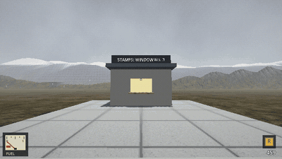 | 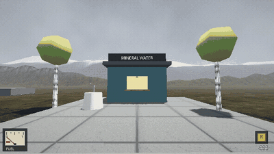 | 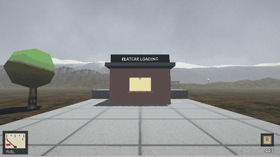 |

The mine and the goat are still played on a flat screen and are next in line to move into the world.

## References

Games this one looks up to (no affiliation with any of them):

- **Outbound** — a home on wheels that you live in and share with friends.
- **Easy Delivery Co.** — small deliveries in a small truck.
- **Papers, Please** — documents, stamps and inspections.
- **Slow Roads** — unhurried driving with nowhere to be.
- **Cat Mail Co.** — a cat post office: sorting parcels, a task list, playing the routine together.
- **Cozy Caravan** — a caravan that trades at markets along the way.
- **ШХД: ЗИМА (It's Winter)** and the other ШХД games — the mood of post-Soviet panel-block towns.

## Keys

| Key | What it does |
|---|---|
| `W A S D`, `Shift`, `Space` | walk, run, jump |
| `M` | map: pick a town, the truck drives itself |
| Left mouse | paws: take things and put them down |
| `E` | everything else: window, bell, door, stove, sit |
| `Esc` | pause; on the left, copies of the world: make one or put one back |
| `V`, `F`, `G` | outside view, flashlight, guide book |
| `F2`, `Tab` | lobby and language, who is aboard |

## How it is built

Godot 4.7 draws; all the logic is Common Lisp (ECL embedded in Godot through
[gdecl](https://github.com/flambard/gdecl)). The scene is built from Lisp, and the running game can
be changed from a REPL — for every connected player at once. A small Cloudflare Worker in `relay/`
passes messages between the host and the guests.

| Path | What is there |
|---|---|
| `lisp/` | the game: one file per subsystem (the Russian README lists them all) |
| `lisp/en.lisp` | English text: Russian string from the code → English |
| `project/mods/` | mods shipped with the game — the town stories live here; see [MODDING.md](MODDING.md) |
| `project/` | Godot project, menu add-ons |
| `tools/` | texture, sound and document generators; tests |
| `relay/` | room server (Cloudflare Worker) |
| `site/`, `deploy/` | the landing page and the web deployment |

Building needs ECL, Godot 4.7 and a patched gdecl checkout; textures and sounds are generated by
the scripts in `tools/` and are not stored in git. The gdecl patch is in `patches/`; ECL and the
toolchain paths are set at the top of the `Makefile` and `web/build.sh`. The browser build is
compiled at `-O0`: ECL's garbage collector loses pointers at `-O2` (a crash at launch, worlds wiped).

## Licence

MIT — see [LICENSE](LICENSE). The Godot add-ons in `project/addons/` keep their own MIT licences.
